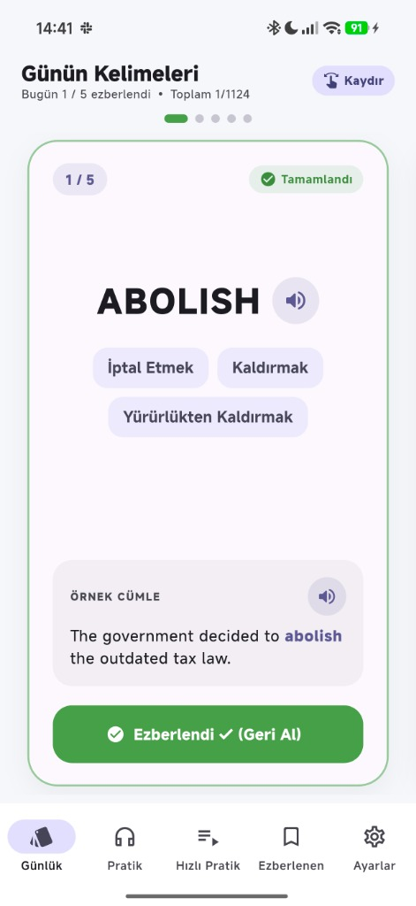
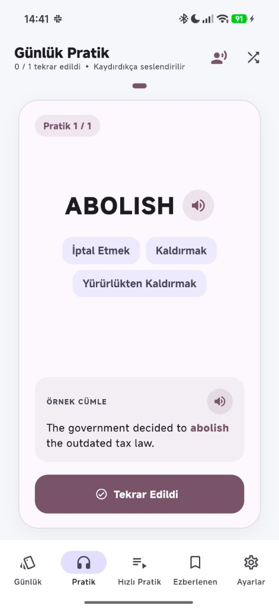
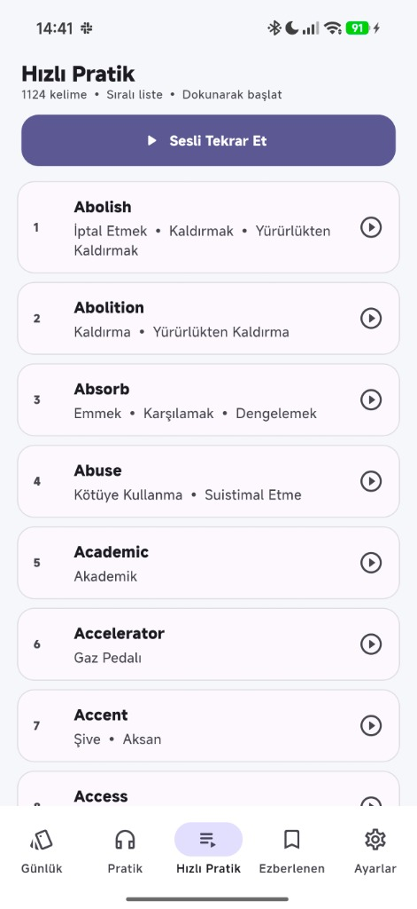
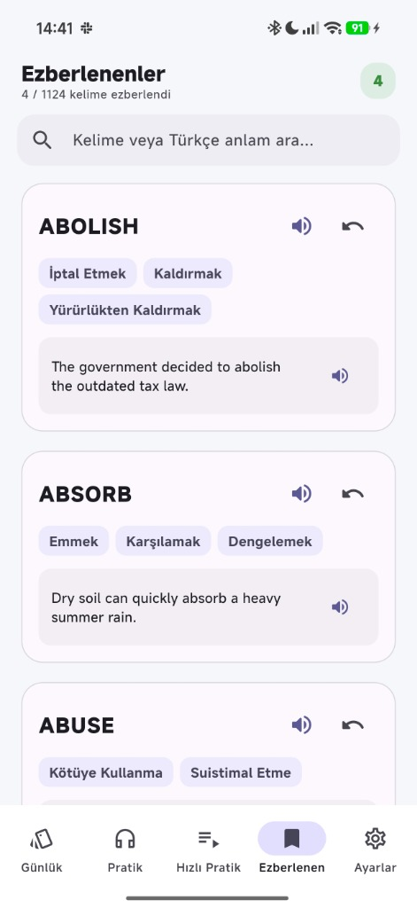
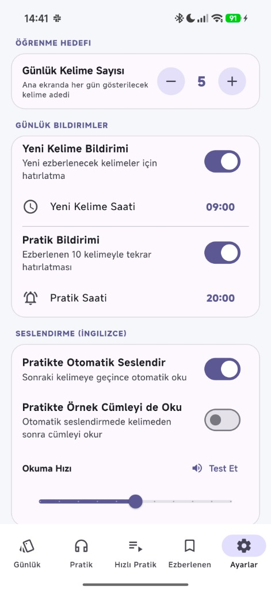

<div align="center">
  
  <h1>Worm — YDS & YÖKDİL Çıkmış Kelimeler</h1>
  <p>
    <strong>YDS, YÖKDİL, YDT ve KPDS/ÜDS sınavlarında çıkmış 1.124 İngilizce kelimeyi</strong>
    günlük kartlar, Amerikan İngilizcesi ve Türkçe offline sesli telaffuz, akıllı tekrar havuzu ve seri sesli okuma ile ezberlemek için geliştirilmiş hafif (lightweight) Flutter Android uygulaması.
  </p>
</div>

---

## Ekran Görüntüleri

| Günlük Kelimeler | Günlük Pratik | Hızlı Pratik |
| :---: | :---: | :---: |
|  |  |  |
| **Ezberlenenler Arşivi** | **Ayarlar** | |
|  |  | |

---

## Öne Çıkan Özellikler

### 1. YDS & YÖKDİL Çıkmış Kelimeler Veri Seti (`1.124 Kelime`)
* Proje kök dizinindeki `words.txt` dosyası, **YDS / YÖKDİL / KPDS / ÜDS** sınavlarında çıkmış **1.124 İngilizce kelimeyi** alfabetik ve numaralı sırasıyla içerir.
* Her kelime kaydı; kelimenin kendisini, `#` ile ayrılmış Türkçe anlamlarını ve kelime için özel hazırlanmış İngilizce örnek cümleyi barındırır.

### 2. Günlük Kelimeler (Instagram Karuseli Deneyimi)
* Her gün belirlediğiniz hedef kadar kelime (varsayılan **5**, ayarlardan **1–20** arası) yatay kaydırılabilir (`PageView`) kartlar halinde sunulur.
* Kart düzeni:
  * Üstte büyük harflerle (`UPPERCASE`) **İngilizce kelime** + seslendirme butonu
  * Ortada **Türkçe anlamlar**
  * Altta hedef kelimenin vurgulandığı **örnek cümle** + seslendirme butonu
  * En altta tek dokunuşla **Ezberlendi** işaretleme butonu
* **Sıra Koruma & Ertesi Güne Devir:** Gün içinde ezberlenmeyen kelimeler sonraki güne **sırası bozulmadan** listenin başında kalmaya devam eder; ezberlenenlerin yerine sıradaki yeni kelimeler eklenir.

### 3. Günlük Pratik (Havuz Mantıklı 10 Kelime & Otomatik Ses)
* Yalnızca **ezberlediğiniz** kelimeler arasından her gün rastgele **10 kelime** seçilir.
* Tüm ezberlenen kelimeler pratikte çıkana kadar aynı kelimeler tekrarlanmaz; havuz tükendiğinde kullanılanlar otomatik olarak tekrar havuza dahil edilir.
* Kartlar arasında istediğiniz kadar sağa/sola kaydırarak dolaşabilirsiniz; bir kelimeden diğerine geçtikçe **otomatik olarak seslendirilir**.

### 4. Hızlı Pratik (1.124 Kelime Sıralı & Seri Sesli Okuma)
* Tüm **1.124 kelime** sırasıyla yalnızca İngilizce kelime ve Türkçe anlamlarıyla listelenir; aşağı kaydırarak tamamına hızlıca ulaşabilirsiniz.
* **Sesli Tekrar Et** butonuna basıldığında kelimeler seri şekilde **önce İngilizcesi, ardından Türkçesi** olarak okunur.
* **Duraklat / Devam Et / Durdur** kontrolleri mevcuttur; listeden herhangi bir kelimeye dokunduğunuzda sesli okuma doğrudan o kelimeden devam eder.

### 5. %100 Offline Amerikan İngilizcesi & Türkçe Seslendirme
* Tüm **1.124 kelime + 1.124 örnek cümle** (`en-US-AriaNeural`) ve **1.124 Türkçe anlam** (`tr-TR-EmelNeural`) için önceden üretilmiş MP3 ses dosyaları uygulama içinde (`assets/audio/`) gömülüdür.
* Cihazın sistem dilinden veya internet bağlantısından bağımsız olarak her kelime ve cümle doğal telaffuzla çalınır.
* İleride `words.txt` dosyasına ses dosyası olmayan yeni bir kelime eklenirse otomatik olarak cihazın `flutter_tts` motoruna fallback yapar.

### 6. Ezberlenenler Kategorisi & Zamanlanmış Bildirimler
* **Ezberlenenler:** Ezberlediğiniz tüm kelimeler, anlamları, örnek cümleleri, seslendirme butonları ve anlık arama çubuğu ile listelenir; istediğiniz kelimeyi geri alıp tekrar günlük sıraya dahil edebilirsiniz.
* **Günlük Bildirimler:** Ayarlar ekranından belirlediğiniz iki ayrı saatte **Yeni Kelime Bildirimi** (varsayılan `09:00`) ve **Pratik Bildirimi** (varsayılan `20:00`) alırsınız. Bildirime dokunduğunuzda doğrudan ilgili sekme açılır.

---

## `words.txt` Formatı ve Yeni Kelime Ekleme

Proje kök dizinindeki `words.txt` dosyasının satır formatı:

```text
yabancı_kelime,turkce_anlam1#turkce_anlam2#..,Örnek yabancı Cümle
```

Örnek:
```text
Abolish,İptal Etmek#Kaldırmak#Yürürlükten Kaldırmak,The government decided to abolish the outdated tax law.
```

> Ayrıştırıcı (`WordParser`) yalnızca ilk iki virgüle göre bölme yaptığı için örnek cümlelerin içinde virgül bulunması sorun oluşturmaz.

> **Not:** Üretilen MP3 ses dosyaları (`.gitignore` nedeniyle) repoda tutulmaz. `flutter run` veya `flutter build apk` çalıştırıldığında Gradle `preBuild` aşamasında [setup_audio.sh](tool/setup_audio.sh) otomatik olarak tetiklenir ve eksik ses dosyalarını `assets/audio/` altına üretip pakete dahil eder.

Manuel olarak üretmek veya sadece sesleri güncellemek için:

```bash
./tool/setup_audio.sh
```

---

## Proje Yapısı

```text
worm/
├── words.txt                              # 1.124 YDS/YÖKDİL kelimesi (kaynak veri)
├── assets/
│   ├── icon_preview.png                   # Uygulama ikonu önizlemesi
│   └── audio/
│       ├── words/                         # İngilizce kelime MP3 dosyaları (en-US)
│       ├── sentences/                     # İngilizce örnek cümle MP3 dosyaları (en-US)
│       └── tr/                            # Türkçe anlam MP3 dosyaları (tr-TR)
├── docs/screenshots/                      # Uygulama ekran görüntüleri
├── tool/
│   ├── generate_audio.py                  # Offline EN/TR MP3 ses üretim scripti
│   └── generate_icons.py                  # Uygulama & bildirim ikonu üretim scripti
├── lib/
│   ├── main.dart                          # Tema, yaşam döngüsü ve 5 sekmeli navigasyon
│   ├── models/word_item.dart              # WordItem modeli ve virgül güvenli parser
│   ├── controllers/app_controller.dart    # Günlük sıra, devir, havuz ve ayar mantığı
│   ├── services/
│   │   ├── tts_service.dart               # Hibrit offline MP3 + TTS fallback servisi
│   │   └── notification_service.dart      # Günlük yerel bildirim servisi
│   ├── widgets/word_flashcard.dart        # Kaydırılabilir kelime kartı bileşeni
│   └── screens/
│       ├── daily_words_screen.dart        # Günlük Kelimeler ekranı
│       ├── practice_screen.dart           # Günlük Pratik (10 rastgele kelime) ekranı
│       ├── quick_practice_screen.dart     # Hızlı Pratik (1.124 kelime seri okuma) ekranı
│       ├── memorized_words_screen.dart    # Ezberlenenler arşivi ve arama ekranı
│       └── settings_screen.dart           # Hedef, bildirim saatleri ve ses ayarları
└── test/widget_test.dart                  # Birim ve widget testleri
```

---

## Kurulum ve Çalıştırma

### Gereksinimler
* Flutter SDK (`>= 3.44`)
* Android SDK (API 36)

### Komutlar

```bash
# Bağımlılıkları yükle
flutter pub get

# Statik analiz
flutter analyze

# Birim ve widget testlerini çalıştır
flutter test

# Android Debug APK oluştur
flutter build apk --debug

# Bağlı Android cihazda veya emülatörde çalıştır
flutter run
```
